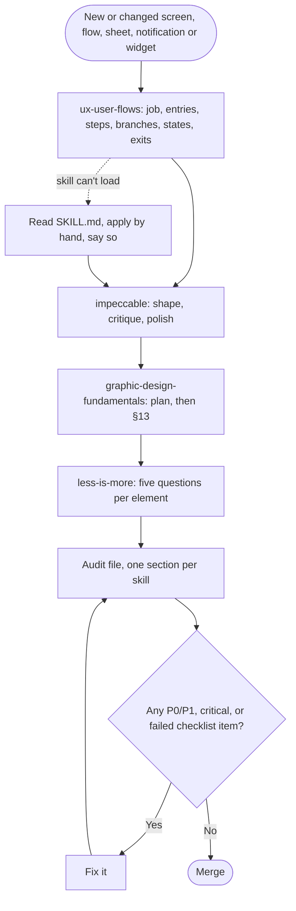

# Audit: a fourth design skill, ux-user-flows (0.31.0)

Date: 2026-11-04 · Auditor: Claude Code

## Scope

- `.claude/skills/ux-user-flows/SKILL.md` added: the owner's claude.ai skill, copied unchanged.
- The rule "three skills" becomes "four skills", ux-user-flows first: AGENTS.md (this repo's audit
  and the apps' rule), `docs/products.md` (the rule text the apps copy), `docs/audit.md`,
  `docs/consuming.md`, `audits/TEMPLATE.md` (a 15-question ux-user-flows section), the PR template,
  README, `VENDORED.md`, and less-is-more's description ("all four").
- New clause in the apps' rule: where a skill's general advice differs from this system, the
  system wins.
- Version 0.31.0. Generated files change only in their version header.

No token, component, asset or screen changes.

## ux-user-flows (§13 flow review checklist)

No app flow changes. The flow this change does alter is the designer's own: how a screen gets
designed and audited. That flow, as the rule now reads:



| # | Question | Result |
|---|---|---|
| 1 | Job | ✅ One actor (the agent or designer), one job: decide what happens before how it looks. |
| 2 | Entries | ✅ Every surface the rule already names (screen, flow, sheet, notification, widget), and changes to this repo. |
| 3 | Happy path | ✅ One section more in the audit file; a change with no flow writes one line, not 15 rows. |
| 4 | Branches | ✅ "Skill won't load" keeps its existing by-hand path. |
| 5 | States | n/a (no UI). |
| 6 | Errors | ✅ Conflicts between the skill and the system are settled by one clause: the system wins. |
| 7 | Control | n/a. |
| 8 | Progress and resume | n/a. |
| 9 | Memory | ✅ The order is written in the rule, not left to recall. |
| 10 | Exits | ✅ Ends in the audit file and the merge rule that already exists. |
| 11 | Conventions | ✅ Same shape as the 0.29.0 rule (vendored, VENDORED.md, re-copy on change). |
| 12 | Speed | n/a. |
| 13 | Accessibility | ✅ The skill's WCAG 2.2 flow criteria add checks this system lacked: 2.4.11 focus not obscured (sheets), 2.5.7 dragging alternatives, 3.3.7 redundant entry, 3.3.8 accessible authentication. |
| 14 | Ethics | ✅ The skill's deceptive-patterns list fits "personal, private, calm tools" (PRODUCT.md). |
| 15 | Evidence | 🟡 Its value is assumed, not measured. Check it on the next real flow in an app (for example Cochilo's or GMind's next new screen) and note there whether the flow step found anything the other three missed. |

Where the skill's general advice meets this system's rules (checked line by line):

| Skill says | System says | Outcome |
|---|---|---|
| Targets ≥ 24×24 CSS px; "use the stricter one" (44pt, 48dp) | 48dp minimum, uikit rows 56dp | Agree: the skill defers to the stricter one. |
| Show progress, percent and a cancel past 10 s | Self-update: "Downloading… 41%", Cancel | Agree. |
| Prefer undo over confirm | — | Adds to the system; no conflict. |
| Errors in plain language, never codes alone | States, not logs; no exception names in UI text | Agree. |
| Mobile: bottom tab bar for 3–5 destinations | PulseLoop has 5 tabs plus a rail from 600dp | Agree. |
| Mark the happy path with an accent line (in diagrams) | One mint action per screen | No conflict: it is about flow diagrams, not screens. |
| "When a project has a design system, its specifics win" | The new clause in the app rule | Agree, and the rule now says so too. |

Issues: none critical or important. Polish: the evidence item above (P3, carried as A-12).

## graphic-design-fundamentals (§13 checklist)

Nothing visual changes. 9 Consistency ✅: the four skills are named in the same order in every doc
that lists them (AGENTS.md, products.md, audit.md, consuming.md, README, VENDORED.md, the
template, the PR template). 10 Simplicity ✅: one skill added, no rule repeated. Every other item
is n/a.

## impeccable (audit, native / Android)

No change to any dimension, and no findings. Accessibility gains the WCAG 2.2 flow checks above
as audit inputs. They are not a score change until an app screen is audited with them.

## less-is-more

| Element | Question (1–5) | Kept / moved / merged / removed, and where |
|---|---|---|
| ux-user-flows skill | 2 Duplicate? Partly: its accessibility and minimalism overlap graphic-design-fundamentals and less-is-more. | Kept. It covers what none of the three does: entry points, branches, the states inventory, forms, errors, onboarding, flow review. The skill states its own lane ("what happens and in what order"). |
| Template section, 15 rows | 5 Rare? Most changes here have no flow. | Kept, with "one line saying none does" so a no-flow change writes a line, not a table. |
| "The system wins" clause | 1 Helps now? Yes: the skill's 24px target and the system's 48dp would otherwise be argued in every audit. | Kept, one sentence. |
| Rewording the old 0.29.0 CHANGELOG entry | 4 Weak for the goal | Not done: history stays as written. |

| Dimension | 0–4 |
|---|---|
| Elements per screen, compared with before | 4 (no screen changes) |
| Duplicates left | 3 (the overlap above, kept on purpose and named) |
| Text to read when tired | 3 (one section more per audit; one line when no flow) |
| Taps on the common actions (must not rise) | 4 (unchanged) |

## Evidence

```
$ python3 scripts/gen_tokens.py      # only the version header changes in generated/
$ python3 scripts/check_tokens.py
check-tokens: 0 error(s), 0 tracked warning(s)
$ python3 -m unittest discover -s tests
OK
```

## Verdict

Merge. Open: A-12 (P3), measure the flow step on the next real app flow.
